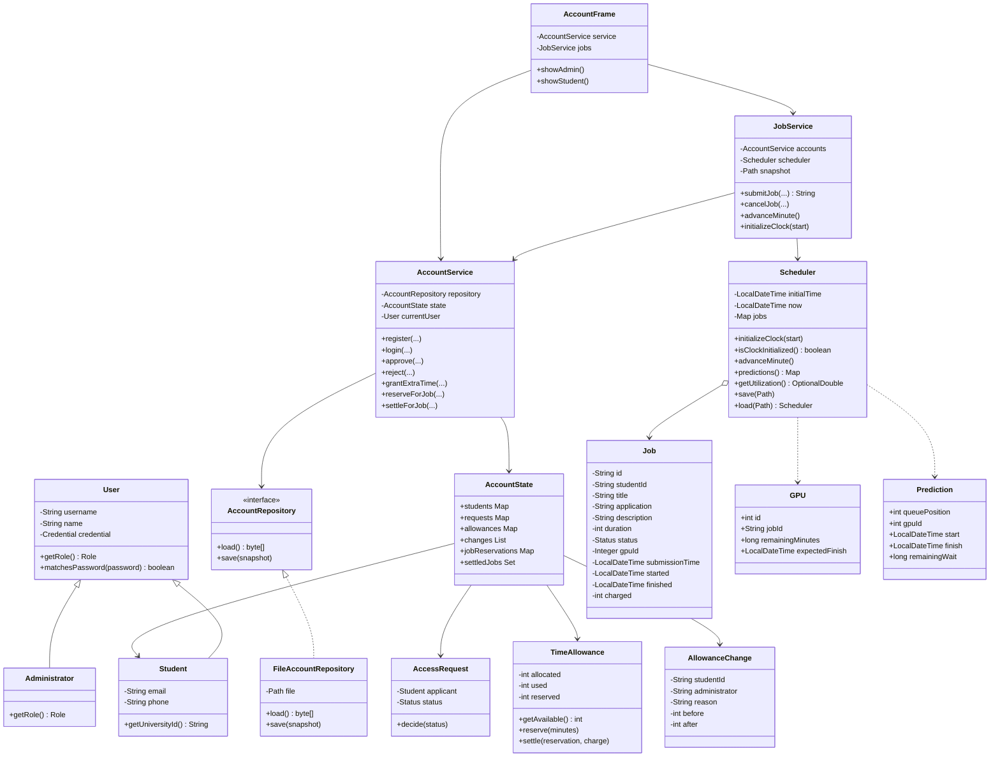

# GPU Utilization Management

A Java Swing application for managing student GPU allowances and simulating
FCFS scheduling on four identical GPUs. GPU execution is simulated; workload
units are not NVIDIA H100 performance measurements.

## Features

- Student registration with administrator approval and account balances.
- Admin allowance adjustments with recorded administrator, simulated time,
  and reason.
- Student job submission, history search, and cancellation.
- Role-specific Swing screens matching the course-guide flows: combined login,
  student registration, student Home/My jobs, and administrator
  Dashboard/Requests/Students/All jobs tabs.
- One FCFS queue, deterministic GPU assignment, minute-by-minute simulation,
  predicted starts/finishes, wait times, and utilization.
- Completed and cancelled job history, including runtime charges and reasons.
- Separate account and scheduler snapshots. The simulation pauses while the
  application is closed; the saved clock and running jobs resume on restart.
- The administrator sets the initial simulation date and time with Swing
  date/time pickers after signing in for the first time. Until then, job
  submission and clock advancement are disabled.

The predefined administrator credentials are `admin` / `gpu2026`. Each
approved student signs in using their university ID and chosen password.

## Requirements

- JDK 17 or newer.
- Windows PowerShell, Command Prompt, or another terminal.

## Build and run (PowerShell)

From the project directory:

```powershell
New-Item -ItemType Directory -Force out
javac -encoding UTF-8 -d out (Get-ChildItem -Path src -Recurse -Filter *.java | ForEach-Object FullName)
java -cp out gpu.accounts.Main
```

On the first administrator sign-in, choose the simulation date and time.
By default, the program stores account data in `data/accounts.dat` and the
simulation in `data/simulation.dat`. Pass alternative paths as the first and second
arguments:

```powershell
java -cp out gpu.accounts.Main data/accounts-demo.dat data/simulation-demo.dat
```

## Sample demonstration data

The sample generator refuses to overwrite either output file. Run it with
fresh paths:

```powershell
java -cp out gpu.scheduling.CreateDemoData
```

It creates five approved students, one pending request, one rejected request,
and 20 allowance-backed jobs across queued, running, completed, and cancelled
states. The sample credentials are:

- Administrator: `admin` / `gpu2026`
- Students `S1` through `S5`: `student123`

Open the generated data with:

```powershell
java -cp out gpu.accounts.Main data/demo-accounts.dat data/demo-simulation.dat
```

## Tests

The project includes dependency-free behavioral checks:

```powershell
java -cp out gpu.scheduling.SchedulerTest
java -cp out gpu.scheduling.JobServiceTest
```

They cover FCFS ordering, GPU tie-breaking, wait predictions, exact and
insufficient allowances, completion, queued and running cancellation charges,
utilization, access scoping, and snapshot recovery.

## Design and class relationships



- `User`, `Student`, and `Administrator` demonstrate inheritance and
  polymorphism; `User` is the shared abstract account type.
- `AccountService` applies account validation, authentication, permissions,
  approvals, allowance changes, and job-minute reservation/settlement.
- `AccountRepository` separates account storage from its file implementation.
- `Scheduler` owns the simulation clock, four-GPU dispatch, FCFS queue,
  execution history, predictions, and utilization calculations.
- `JobService` coordinates authenticated job actions with allowances and
  scheduler persistence.
- `AccountFrame` is the Swing interface; domain operations remain in the
  account and scheduling services.

## Assumptions

- A job’s selected size maps to 5, 15, 30, or 60 simulated GPU minutes.
- Jobs submitted in the same simulated minute are ordered by generated job ID.
- The first free GPU is selected by increasing ID; predictions use copied
  availability times and do not change live assignments.
- Running cancellations charge elapsed simulated runtime; queued cancellations
  charge zero. A completed job is charged once for its full duration.
- Account and scheduler snapshots are stored in separate files under `data/`.
  Keep both files together when backing up or moving a simulation.

Screenshots, individual GitHub contribution evidence, and the course report
must be added by the project group during its own demonstration and submission.
